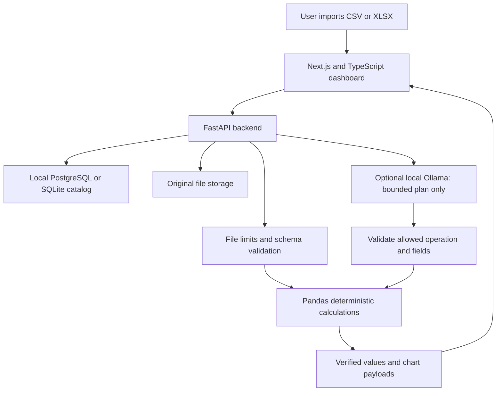

# Architecture and calculation rules

## Complete local application



This diagram describes the full local project. This repository includes only the selected Python calculation module, a React chart component, and demonstration files. The Netlify website is a separate synthetic-data interface demo.

## Numerical example

The solar fixture contains measurements at seconds 0, 1, 2, 3, and 10. Power is missing at second 2. The accepted maximum gap is two seconds.

Only seconds 0 to 1 have both valid endpoint values and an acceptable gap:

```text
average endpoint power = (1,000 W + 1,200 W) / 2 = 1,100 W
energy = 1,100 W × 1 second / 3,600 / 1,000
       = 0.00030555555555555555 kWh
```

The two intervals touching the missing observation are excluded. The seven-second gap is also excluded. Integration uses the trapezoidal rule and does not fill missing observations or extrapolate beyond accepted intervals.

Mean, minimum, maximum, and sum use valid observations and report the missing count. Trend means last minus first valid observation in row order; it is not a time-normalized rate. A sum of power readings is not energy.

## Limits of the selected engine

- CSV input is UTF-8 with comma delimiters. XLSX uses the first worksheet and reads saved formula caches without evaluating formulas.
- Headers must be nonempty and unique. A mixed numeric/text column remains text.
- Default input bounds are 25 MB, 10,000 columns, 100,000 rows, and 1,000,000 data cells. Limits apply together. A wide sheet of 10,000 columns by 100 rows reaches the cell cap.
- Expanded XLSX contents and decoded DataFrame memory are checked. These are application checks, not process isolation or a guarantee that parsing arbitrary untrusted files cannot exhaust memory.
- Energy needs explicit W or kW units, valid strictly increasing unique timestamps, a positive gap limit, and at least one accepted adjacent interval.
- The included regression check covers the small fixtures. It does not benchmark wide workbook performance or validate the complete application.

## AI boundary

In the complete local application, Ollama can choose from supported analyses and chart plans. The backend validates the plan and calls deterministic functions. It never executes arbitrary model-generated Python. The runnable portfolio sample does not call a language model.
